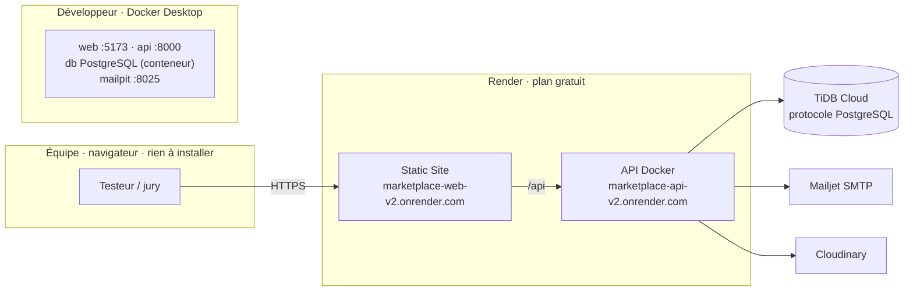
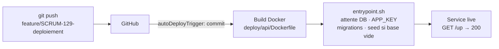

# Marketplace B2B

Plateforme de gestion des achats et des ventes entre **fournisseurs** et **porteurs de projet** — projet d'intégration, ISET Djerba.

Le porteur de projet publie un besoin ou commande un produit, les fournisseurs répondent par des devis, la commande est payée puis suivie jusqu'à la facture, et l'administrateur supervise la plateforme. L'IA aide à décider sans jamais décider à la place de l'utilisateur.

**Démo en ligne** (aucune installation) : application <https://marketplace-web-v2.onrender.com> · état de l'API <https://marketplace-api-v2-8gr1.onrender.com/up>

| Dossier | Contenu | Stack |
|---|---|---|
| `backend/` | API REST | Laravel 12, PHP 8.2+, PostgreSQL (TiDB Cloud en production) / MySQL local possible, Sanctum (jetons Bearer) |
| `frontend/` | Application web (et base de l'application mobile) | React 19, Vite, React Router, Zustand, Axios, Tailwind CSS 4 |
| `deploy/` | Stack locale (Docker) et image de production | Docker Compose, nginx + PHP-FPM, PostgreSQL 17, Mailpit |
| `docs/` | Décisions de l'équipe et conventions | Markdown |

Backlog et sprints : Jira, projet **SCRUM**.

## Prérequis

- PHP 8.2 ou plus, Composer 2
- PostgreSQL 14+ (recommandé, parité avec la production TiDB) ou MySQL 8 / MariaDB 10.6+
- Node.js 20 ou plus, npm
- Docker Desktop (optionnel) pour lancer la stack complète via `deploy/`

## Installation

### Option A — Docker (recommandé, PostgreSQL)

```bash
./deploy/start.sh   # API http://localhost:8000, Web http://localhost:5173, Mailpit http://localhost:8025
```

Voir [`deploy/README.md`](deploy/README.md) et la procédure de mise en production dans [`docs/DEPLOYMENT.md`](docs/DEPLOYMENT.md).

### Option B — Installation manuelle

#### 1. API (backend)

```bash
cd backend
composer install
cp .env.example .env          # DB_CONNECTION/DB_HOST/DB_DATABASE/DB_USERNAME/DB_PASSWORD (pgsql par défaut)
php artisan key:generate
php artisan migrate --seed    # crée les tables, les régions et les catégories
php artisan serve             # http://localhost:8000
```

Exemples de création de base :
- PostgreSQL : `createdb marketplace_b2b` (ou via votre client)
- MySQL : `CREATE DATABASE marketplace_b2b CHARACTER SET utf8mb4 COLLATE utf8mb4_unicode_ci;` puis `DB_CONNECTION=mysql` dans `.env`

Le seeder insère toujours les données de référence (24 régions, catégories) nécessaires aux formulaires. Les comptes de démonstration ne sont créés que si `SEED_DEMO_DATA=true` (variable d'environnement).

### 2. Application web (frontend)

```bash
cd frontend
npm install
cp .env.example .env          # VITE_API_URL=http://localhost:8000/api
npm run dev                   # http://localhost:5173
```

### Dépannage : « Impossible de charger les régions »

Ce message apparaît dans les formulaires d'inscription quand l'API ne peut pas lire les données de référence : le plus souvent, **MySQL/MariaDB n'est pas démarré** et Laravel répond `500`.

1. Démarrez MySQL (XAMPP : panneau de contrôle ou `C:\xampp\mysql_start.bat`).
2. Vérifiez que l'API répond :

```bash
curl http://localhost:8000/api/reference/regions
```

La réponse doit être un tableau JSON de **24 régions**. Si la base est vide, relancez `php artisan db:seed` depuis `backend/` (le seeder insère toujours les régions et les catégories).

### Comptes de démonstration

Mot de passe : `password`

| Rôle | E-mail |
|---|---|
| Administrateur | admin@marketplace.test |
| Fournisseur | fournisseur@marketplace.test |
| Porteur de projet | porteur@marketplace.test |

### Catalogue de démonstration (sprint 2)

Fournisseurs, produits, avis et favoris des maquettes (Atlas Emballages, Djerba Pack, PalettesPlus…) :

```bash
cd backend
php artisan storage:link                            # photos des produits et logos (disque « public »)
php artisan db:seed --class=CatalogueDemoSeeder     # relançable sans doublons
```

Il est aussi lancé par `php artisan migrate --seed` lorsque `SEED_DEMO_DATA=true`.
Mot de passe : `password`.

| Rôle | E-mail |
|---|---|
| Fournisseur validé (Atlas Emballages) | atlas@marketplace.test |
| Porteur de projet avec 6 favoris (Sana Ben Salah) | sana@marketplace.test |

Parcours de démo : accueil → recherche → catalogue filtré → fiche produit → fiche fournisseur → favori ;
côté fournisseur : Mes produits → Ajouter un produit → le voir dans le catalogue.

## Tests

```bash
cd backend && php artisan test     # tests PHPUnit (base SQLite en mémoire)
cd frontend && npm test            # tests Vitest + Testing Library
```

Les deux suites tournent automatiquement sur chaque pull request (GitHub Actions).

## Architecture en bref

- **Authentification** : `POST /api/auth/login` renvoie un jeton Sanctum, envoyé ensuite dans l'en-tête `Authorization: Bearer …`. Le même mécanisme sert au web et au mobile.
- **Vérification de l'e-mail** : à l'inscription, l'événement `Registered` envoie un lien signé (valable 60 min, `AUTH_VERIFICATION_EXPIRE`, un seul usage) qui ouvre la page React `/email/verifier` (`FRONTEND_URL`). Tant que l'adresse n'est pas vérifiée, l'utilisateur peut se connecter et redemander un lien (`POST /api/auth/email/resend`, 1 par minute), mais le middleware `verified` lui ferme les espaces métier. En local (`MAIL_MAILER=log`), le lien se trouve dans `storage/logs/laravel.log`.
- **Paramètres du compte** : `GET /api/account`, `PATCH /api/account/profile`, `PATCH /api/account/email` et `PUT /api/account/password` (page React `/parametres`). Le changement d'e-mail repasse le compte en « e-mail à vérifier » et envoie un nouveau lien ; le changement de mot de passe exige l'ancien et révoque les autres sessions.
- **Connexion et mot de passe** : « Se souvenir de moi » donne un jeton de 7 jours (sinon 12 h, `AUTH_SESSION_HOURS`). « Mot de passe oublié » (`POST /api/auth/forgot-password` puis `/reset-password`) envoie un lien valable 60 min et à usage unique vers la page React `/mot-de-passe/nouveau` ; changer son mot de passe ferme toutes les sessions ouvertes.
- **Désactivation et suppression du compte** : `POST /api/account/deactivate` et `DELETE /api/account` (page React `/parametres`) exigent le mot de passe actuel et révoquent tous les jetons Sanctum. La suppression est douce : commandes, factures et avis sont conservés et le profil fournisseur disparaît du catalogue (`SupplierProfile::visibleInCatalog`).
- **Rôles** : `supplier` (fournisseur), `buyer` (porteur de projet), `admin`. Côté API, chaque groupe de routes est protégé par le middleware `role:` ; côté React, chaque espace est protégé par un `loader` de garde (`router/routes.jsx`, règles dans `router/guard.js`).
- **Fournisseur non validé** (SCRUM-27) : tant que l'administrateur n'a pas validé son dossier, il arrive sur `/fournisseur/en-attente` (état du dossier via `GET /api/supplier/validation-status`) et peut compléter son profil sans le publier. Les pages de vente (produits, devis) passent par le middleware `supplier.validated` (403 `{ "reason": "supplier_not_validated" }`, redirection automatique côté React) ; après un refus, l'envoi d'un nouveau justificatif repasse le dossier « en attente ».
- **Organisation du backend** : `Controllers/Api` (minces) → `Http/Requests` (validation) → `Services` (règles métier) → `Models`, réponses via `Http/Resources`.
- **Organisation du frontend** : `api/http.js` (client unique, gestion des erreurs 401/403), `stores/` (Zustand), `router/` (adresses, routes et gardes par rôle), `layouts/`, `components/`, `views/<espace>/`.

## Environnements et déploiement

Trois façons d'utiliser le projet, à ne pas confondre : **consulter l'application** ne demande
aucune installation, **modifier le code** se fait en local sur une base jetable, et la base
**TiDB** n'existe qu'en production.

| Environnement | Pour qui | Base de données | Mise en route |
|---|---|---|---|
| **Démo publique** (Render) | toute l'équipe, le jury, les testeurs | TiDB Cloud | ouvrir <https://marketplace-web-v2.onrender.com> |
| **Local** (Docker) | développement, modifications de code | PostgreSQL 17 en conteneur | `./deploy/start.sh` |
| **Production** | Render (mise à jour automatique) | TiDB Cloud | `git push` sur la branche suivie |



La base locale et la base de production sont **complètement séparées** : un `migrate:fresh`
lancé en local ne touche jamais la démo publique, et personne n'a besoin du mot de passe TiDB
pour travailler.

### Chaîne de déploiement



Détail des variables, de la base TiDB, de Mailjet et de la vérification des e-mails :
[`docs/DEPLOYMENT.md`](docs/DEPLOYMENT.md). Stack locale et override TiDB :
[`deploy/README.md`](deploy/README.md). Décisions correspondantes :
[`docs/decisions.md`](docs/decisions.md) (D11 à D14).

## Travailler ensemble

Voir [`docs/CONTRIBUTING.md`](docs/CONTRIBUTING.md) : branches, commits liés à Jira, pull requests. Les décisions d'équipe sont notées dans [`docs/decisions.md`](docs/decisions.md).
# marketplace-b2b
