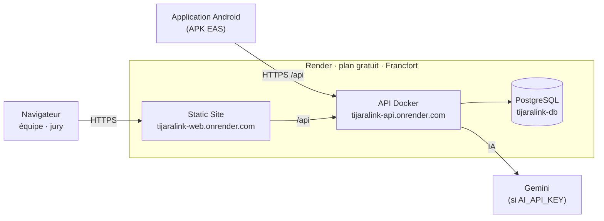
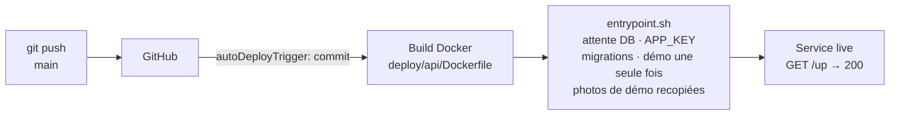

# Marketplace B2B

Plateforme de gestion des achats et des ventes entre **fournisseurs** et **porteurs de projet** — projet d'intégration, ISET Djerba.

Le porteur de projet publie un besoin ou commande un produit, les fournisseurs répondent par des devis, la commande est payée puis suivie jusqu'à la facture, et l'administrateur supervise la plateforme. L'IA aide à décider sans jamais décider à la place de l'utilisateur.

**Démo en ligne** (aucune installation) : application <https://tijaralink-web.onrender.com> · état de l'API <https://tijaralink-api.onrender.com/up> · application Android : APK fabriqué avec EAS ([`mobile/`](mobile/README.md))

| Dossier | Contenu | Stack |
|---|---|---|
| `backend/` | API REST | Laravel 12, PHP 8.2+, PostgreSQL (TiDB Cloud en production) / MySQL local possible, Sanctum (jetons Bearer) |
| `frontend/` | Application web | React 19, Vite, React Router, Zustand, Axios, Tailwind CSS 4 |
| `mobile/` | Application mobile (même API, même design que le site) | React Native 0.88, Expo SDK 58, React Navigation |
| `deploy/` | Stack locale (Docker) et image de production | Docker Compose, nginx + PHP-FPM, PostgreSQL 17, Mailpit |
| `docs/` | Décisions de l'équipe et conventions | Markdown |

Backlog et sprints : Jira, projet **SCRUM**.

## Prérequis

- PHP 8.2 ou plus, Composer 2
- PostgreSQL 14+ (recommandé, parité avec la production TiDB) ou MySQL 8 / MariaDB 10.6+
- Node.js 20 ou plus, npm
- Docker Desktop (optionnel) pour lancer la stack complète via `deploy/`
- Pour le mobile : l'application **Expo Go** sur le téléphone (Play Store / App Store), téléphone et PC sur le même Wi-Fi

## Installation

### Option A — Docker (recommandé, PostgreSQL)

```bash
./deploy/start.sh   # API http://localhost:8000, Web http://localhost:5173, Mailpit http://localhost:8025
```

Voir [`deploy/README.md`](deploy/README.md) et la procédure de mise en production dans [`docs/DEPLOYMENT.md`](docs/DEPLOYMENT.md).

### Option B — Installation manuelle

#### 1. API (backend)

```bash
cd backend
composer install
cp .env.example .env          # DB_CONNECTION/DB_HOST/DB_DATABASE/DB_USERNAME/DB_PASSWORD (pgsql par défaut)
php artisan key:generate
php artisan migrate --seed    # crée les tables, les régions et les catégories
php artisan serve             # http://localhost:8000
```

Exemples de création de base :
- PostgreSQL : `createdb marketplace_b2b` (ou via votre client)
- MySQL : `CREATE DATABASE marketplace_b2b CHARACTER SET utf8mb4 COLLATE utf8mb4_unicode_ci;` puis `DB_CONNECTION=mysql` dans `.env`

Le seeder insère toujours les données de référence (24 régions, catégories) nécessaires aux formulaires. Les comptes de démonstration ne sont créés que si `SEED_DEMO_DATA=true` (variable d'environnement).

### 2. Application web (frontend)

```bash
cd frontend
npm install
cp .env.example .env          # VITE_API_URL=http://localhost:8000/api
npm run dev                   # http://localhost:5173
```

### 3. Application mobile (Expo)

Le mobile utilise **la même API et la même base** que le site : tout ce qui est fait d'un côté apparaît de l'autre.
Sur un vrai téléphone, l'API doit écouter sur le réseau et sur le port **8001** :

```bash
cd backend
php artisan serve --host=0.0.0.0 --port=8001
```

Puis, dans un autre terminal :

```bash
cd mobile
npm install
npm run start:phone           # Metro sur http://<IP du PC>:8081, QR code à scanner avec Expo Go
```

`start:phone` fixe l'IP du PC (`192.168.1.83`) dans `package.json` : si `ipconfig` donne une autre adresse pour la
carte « Wi-Fi », modifiez-la. Autres commandes : `npx expo start` (touche `a` : émulateur Android, `w` : navigateur),
`npm run start:tunnel` (réseau qui bloque les appareils entre eux).

L'adresse de l'API est trouvée toute seule : l'application reprend l'IP du PC qui sert Metro et vise le port 8001
(émulateur Android : `10.0.2.2`, navigateur : `localhost`). Pour la forcer, créez `mobile/.env` :

```bash
EXPO_PUBLIC_API_URL=http://192.168.1.83:8001/api
EXPO_PUBLIC_WEB_URL=http://192.168.1.83:5173
```

Pour tester dans le navigateur (`npx expo start --web`, port 8081), ajoutez l'origine au CORS du backend :
`FRONTEND_URLS=http://localhost:5173,http://localhost:8081` dans `backend/.env`.

**Écrans.** Chaque espace a 4 onglets et un onglet **Menu** qui reprend la barre latérale du site :

| Visiteur | Porteur de projet | Fournisseur | Administrateur |
|---|---|---|---|
| Accueil, catalogue, fiche produit, connexion | Tableau de bord, mes demandes, publier une demande, mes commandes, fournisseurs favoris, mes litiges, assistant IA, messagerie, notifications, paramètres | Tableau de bord, mes produits, demandes reçues, mes devis, mes commandes, mes avis (réponse), litiges reçus, assistant IA, messagerie, notifications, profil de l'entreprise, paramètres | Tableau de bord, validation fournisseurs, utilisateurs, catégories, contrôle du catalogue, avis signalés, litiges, journal d'audit, notifications |

Restent sur le site (lien direct depuis l'application) : inscription, mot de passe oublié, pièces jointes, dépôt d'un
devis, décision d'un litige, modification du profil et des catégories. L'application se rafraîchit à chaque retour sur
un écran, toutes les 10 s dans la messagerie et toutes les 30 s pour les badges.

**APK Android** : `npm install -g eas-cli`, `eas login`, puis `eas build -p android --profile preview` depuis `mobile/`.

**Organisation** : `App.js` (navigation par rôle), `src/config.js` (adresses API et site), `src/theme.js` (couleurs),
`src/api/client.js` (jeton Sanctum, erreurs en français), `src/auth/` (session dans le trousseau du téléphone),
`src/components/`, `src/screens/`.

### Dépannage mobile : « There was a problem running the requested app »

Ce message d'Expo Go veut presque toujours dire que **le téléphone ne joint pas Metro** sur le PC. Le code n'est pas en
cause (`npx expo-doctor` pour le vérifier).

1. **Un seul Metro, sur le port 8081.** Si un autre `expo start` tourne déjà (autre terminal, autre copie du projet),
   Expo prend le port suivant (8082…), souvent bloqué par le pare-feu. Pour trouver et arrêter l'autre :
   ```powershell
   Get-NetTCPConnection -State Listen -LocalPort 8081,8082 | Select-Object LocalPort,OwningProcess
   Stop-Process -Id <OwningProcess>
   ```
2. **Pare-feu Windows** : ouvrir 8081 (Metro) et 8001 (API) pour le profil « Privé » (PowerShell en administrateur),
   et mettre le Wi-Fi en profil **Privé** (Paramètres → Réseau et Internet → Wi-Fi) :
   ```powershell
   New-NetFirewallRule -DisplayName "Expo Metro 8081" -Direction Inbound -Protocol TCP -LocalPort 8081 -Action Allow -Profile Private
   New-NetFirewallRule -DisplayName "Laravel API 8001" -Direction Inbound -Protocol TCP -LocalPort 8001 -Action Allow -Profile Private
   ```
3. **Même Wi-Fi et bonne IP** dans `start:phone` (et dans `mobile/.env` s'il existe).
4. **L'application s'ouvre mais affiche « Impossible de joindre le serveur »** : l'API n'écoute pas sur le réseau,
   relancez-la avec `--host=0.0.0.0 --port=8001`.

Si le message persiste, touchez « View error log » dans Expo Go pour voir l'erreur exacte.

### Dépannage : « Impossible de charger les régions »

Ce message apparaît dans les formulaires d'inscription quand l'API ne peut pas lire les données de référence : le plus souvent, **MySQL/MariaDB n'est pas démarré** et Laravel répond `500`.

1. Démarrez MySQL (XAMPP : panneau de contrôle ou `C:\xampp\mysql_start.bat`).
2. Vérifiez que l'API répond :

```bash
curl http://localhost:8000/api/reference/regions
```

La réponse doit être un tableau JSON de **24 régions**. Si la base est vide, relancez `php artisan db:seed` depuis `backend/` (le seeder insère toujours les régions et les catégories).

### Comptes de démonstration

Créés par `php artisan migrate --seed` avec `SEED_DEMO_DATA=true` (catalogue avec photos, demandes, commandes, avis,
litiges). Lancez aussi `php artisan storage:link` pour les photos. Les mêmes comptes servent au web et au mobile.

Mot de passe de tous les comptes : `password`.

| Rôle | E-mail | À montrer |
|---|---|---|
| Administrateur | admin@tijaralink.test | tableau de bord, fournisseur en attente, avis signalé, litiges |
| Porteur de projet | sana@tijaralink.test | demande avec 3 devis à comparer (résumé IA), commandes, messagerie |
| Porteur de projet | karim@tijaralink.test | litige ouvert sur une commande livrée |
| Porteur de projet | youssef@tijaralink.test | litige décidé, commande validée |
| Fournisseur | atlas@tijaralink.test | demandes reçues, devis, produits, avis et résumé IA |
| Fournisseur | batisud@tijaralink.test | avis suspect signalé à l'administrateur |
| Fournisseur en attente | fournisseur.attente@tijaralink.test | page « dossier en attente de validation » |

Parcours de démo : accueil → catalogue → fiche produit → fiche fournisseur → connexion porteur → comparer les devis →
accepter ; côté fournisseur : Mes produits → Ajouter un produit → le voir dans le catalogue.

## Tests

```bash
cd backend && php artisan test     # tests PHPUnit (base SQLite en mémoire)
cd frontend && npm test            # tests Vitest + Testing Library
```

Les deux suites tournent automatiquement sur chaque pull request (GitHub Actions).

## Architecture en bref

- **Authentification** : `POST /api/auth/login` renvoie un jeton Sanctum, envoyé ensuite dans l'en-tête `Authorization: Bearer …`. Le même mécanisme sert au web et au mobile.
- **Vérification de l'e-mail** : à l'inscription, l'événement `Registered` envoie un lien signé (valable 60 min, `AUTH_VERIFICATION_EXPIRE`, un seul usage) qui ouvre la page React `/email/verifier` (`FRONTEND_URL`). Tant que l'adresse n'est pas vérifiée, l'utilisateur peut se connecter et redemander un lien (`POST /api/auth/email/resend`, 1 par minute), mais le middleware `verified` lui ferme les espaces métier. En local (`MAIL_MAILER=log`), le lien se trouve dans `storage/logs/laravel.log`.
- **Paramètres du compte** : `GET /api/account`, `PATCH /api/account/profile`, `PATCH /api/account/email` et `PUT /api/account/password` (page React `/parametres`). Le changement d'e-mail repasse le compte en « e-mail à vérifier » et envoie un nouveau lien ; le changement de mot de passe exige l'ancien et révoque les autres sessions.
- **Connexion et mot de passe** : « Se souvenir de moi » donne un jeton de 7 jours (sinon 12 h, `AUTH_SESSION_HOURS`). « Mot de passe oublié » (`POST /api/auth/forgot-password` puis `/reset-password`) envoie un lien valable 60 min et à usage unique vers la page React `/mot-de-passe/nouveau` ; changer son mot de passe ferme toutes les sessions ouvertes.
- **Désactivation et suppression du compte** : `POST /api/account/deactivate` et `DELETE /api/account` (page React `/parametres`) exigent le mot de passe actuel et révoquent tous les jetons Sanctum. La suppression est douce : commandes, factures et avis sont conservés et le profil fournisseur disparaît du catalogue (`SupplierProfile::visibleInCatalog`).
- **Messagerie et temps réel (S5)** : `php artisan reverb:start` (port 8080) diffuse messages, accusés de lecture et notifications ; réglages `REVERB_*` (backend) et `VITE_REVERB_*` (frontend, mêmes valeurs). Sans Reverb, tout fonctionne avec un rafraîchissement régulier. Les notifications passent par la file : lancez aussi `php artisan queue:work` (ou `QUEUE_CONNECTION=sync`).
- **Litiges (S5)** : l'acheteur signale un problème de l'expédition à la livraison, l'admin prend en charge puis décide (`/admin/litiges`). Règles : D14 et D15 de [`docs/decisions.md`](docs/decisions.md).
- **Utilisateurs (S5)** : `/admin/utilisateurs` pour suspendre, réactiver ou supprimer un compte (D16, D22). Toute action d'un admin passe par `AuditLogger` (table `audit_logs`).
- **IA (S5)** : `AI_PROVIDER=simulated` (sans clé), `gemini` (API Gemini de Google : clé dans `AI_API_KEY` du `.env`, modèle par défaut `gemini-3.5-flash-lite`) ou `disabled`. Pour brancher un fournisseur : une classe qui implémente `App\Services\Ai\AiClient`, ajoutée à `drivers` dans `config/ai.php`. Nouvelle fonctionnalité : passer par `AiService::run()` (limite, validation, enregistrement).
- **WhatsApp (S5)** : `WHATSAPP_PROVIDER=simulated` (rien n'est envoyé) ou `disabled` ; `WHATSAPP_SIMULATE_FAILURE=true` pour tester le repli sur l'e-mail. Pour brancher un fournisseur : une classe qui implémente `App\Services\WhatsApp\WhatsAppClient`, ajoutée à `drivers` dans `config/whatsapp.php`.
- **Taille des fichiers** : messages 10 Mo, litiges 5 × 5 Mo. Les réglages par défaut de PHP sont plus bas (2 Mo) : mettez `upload_max_filesize=10M` et `post_max_size=32M` dans `php.ini`.
- **Rôles** : `supplier` (fournisseur), `buyer` (porteur de projet), `admin`. Côté API, chaque groupe de routes est protégé par le middleware `role:` ; côté React, chaque espace est protégé par un `loader` de garde (`router/routes.jsx`, règles dans `router/guard.js`).
- **Fournisseur non validé** (SCRUM-27) : tant que l'administrateur n'a pas validé son dossier, il arrive sur `/fournisseur/en-attente` (état du dossier via `GET /api/supplier/validation-status`) et peut compléter son profil sans le publier. Les pages de vente (produits, devis) passent par le middleware `supplier.validated` (403 `{ "reason": "supplier_not_validated" }`, redirection automatique côté React) ; après un refus, l'envoi d'un nouveau justificatif repasse le dossier « en attente ».
- **Organisation du backend** : `Controllers/Api` (minces) → `Http/Requests` (validation) → `Services` (règles métier) → `Models`, réponses via `Http/Resources`.
- **Organisation du frontend** : `api/http.js` (client unique, gestion des erreurs 401/403), `stores/` (Zustand), `router/` (adresses, routes et gardes par rôle), `layouts/`, `components/`, `views/<espace>/`.

## Environnements et déploiement

Deux façons d'utiliser le projet, à ne pas confondre : **consulter l'application** ne demande
aucune installation, **modifier le code** se fait en local sur une base jetable.

| Environnement | Pour qui | Base de données | Mise en route |
|---|---|---|---|
| **Démo publique** (Render) | toute l'équipe, le jury, les testeurs | PostgreSQL Render | ouvrir <https://tijaralink-web.onrender.com> |
| **Application mobile** | téléphones Android | (appelle l'API Render) | APK fabriqué par EAS Build, voir [`mobile/README.md`](mobile/README.md) |
| **Local** | développement, modifications de code | MySQL (Laragon) ou PostgreSQL en conteneur | voir « Installation » ci-dessus, ou `./deploy/start.sh` |

Comptes de démonstration (mot de passe `password`) : `admin@tijaralink.test`, `sana@tijaralink.test`
(porteur de projet), `atlas@tijaralink.test` (fournisseur).



La base locale et la base de production sont **complètement séparées** : un `migrate:fresh`
lancé en local ne touche jamais la démo publique.

### Chaîne de déploiement

Tout est décrit dans [`render.tijaralink.yaml`](render.tijaralink.yaml) (Blueprint Render) :
base PostgreSQL, API Docker et site statique. Un `git push` sur `main` redéploie automatiquement.



- **Base** : créée par Render et reliée à l'API sans mot de passe à copier (`fromDatabase`).
  Remplie au premier démarrage avec la démo complète (`php artisan demo:reset`, jeton `RESET_DEMO_TOKEN`) ;
  changer la valeur du jeton pour la recréer.
- **Seul secret** : `AI_API_KEY` (clé Gemini), saisie dans le tableau de bord Render. Sans elle, l'IA reste en mode simulé.
- **Plan gratuit** : l'API s'endort sans visite (premier appel ~30-60 s), pas de temps réel (rafraîchissement
  toutes les 30 s), base gratuite supprimée par Render 30 jours après sa création.
- **Créer le déploiement** : Render → New → Blueprint → dépôt, branche `main`, chemin `render.tijaralink.yaml`.

Alternative avec TiDB Cloud, Mailjet et Cloudinary (premier déploiement de l'équipe) :
[`docs/DEPLOYMENT.md`](docs/DEPLOYMENT.md). Stack locale Docker : [`deploy/README.md`](deploy/README.md).
Décisions correspondantes : [`docs/decisions.md`](docs/decisions.md) (D11 à D14).

## Travailler ensemble

Voir [`docs/CONTRIBUTING.md`](docs/CONTRIBUTING.md) : branches, commits liés à Jira, pull requests. Les décisions d'équipe sont notées dans [`docs/decisions.md`](docs/decisions.md).
