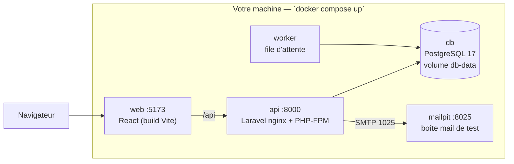

# Lancer le projet en une commande (Docker)

Tout le projet tourne dans Docker : rien d'autre à installer (ni PHP, ni PostgreSQL, ni Node).
La stack locale est **isolée de la production** : elle a sa propre base, ses propres fichiers, sa propre boîte mail.



Rien à configurer : la base est un conteneur, pas un serveur à installer. Vous n'avez
**pas** besoin d'accéder à TiDB pour tester l'application — c'est le rôle des URLs Render
(cf. [README principal](../README.md#environnements)).

## Services

| Service | Adresse | Rôle |
|---|---|---|
| web | http://localhost:5173 | Application React (build Vite servi par nginx) |
| api | http://localhost:8000 | API Laravel (nginx + PHP-FPM) |
| worker | — | File d'attente (diffusion des demandes, e-mails) |
| mailpit | http://localhost:8025 | Boîte de réception des e-mails de test |
| db | — | PostgreSQL 17, données conservées dans le volume `db-data` |

## Prérequis

[Docker Desktop](https://www.docker.com/products/docker-desktop/) (ou Docker Engine + le plugin `docker compose`).

## Démarrer

```bash
./deploy/start.sh
```

La première fois, la construction des images prend quelques minutes. Le script attend que l'API réponde puis affiche les adresses.

Sous Windows sans terminal bash : `docker compose -f deploy/docker-compose.yml up -d --build`.

> Toujours avec `--build` : le code est **copié** dans les images (pas de dossier partagé).
> Sans `--build` vous exécutez l'ancienne version de l'image, pas votre dernier commit.

**Comptes de démonstration** (créés au premier démarrage, mot de passe `password`) :
`admin@marketplace.test`, `buyer1@marketplace.test` … `buyer5@marketplace.test`, `supplier1@marketplace.test` … `supplier8@marketplace.test`
(`supplier7` est en attente de validation, `supplier8` refusé).

## Commandes utiles

| Action | Commande |
|---|---|
| Arrêter (données conservées) | `./deploy/stop.sh` |
| Tout effacer (base recréée avec les données de démo au prochain démarrage) | `./deploy/stop.sh --reset` |
| Prendre en compte un `git pull` ou une modification du code | `./deploy/start.sh` (reconstruit les images) |
| Voir les journaux de l'API/worker | `docker compose -f deploy/docker-compose.yml logs -f api worker` |
| Lancer une commande Artisan | `docker compose -f deploy/docker-compose.yml exec api php artisan migrate:status` |
| Vérifier l'état des services | `docker compose -f deploy/docker-compose.yml ps` |

Pour développer au quotidien avec rechargement à chaud, suivez plutôt l'installation classique du [README principal](../README.md).

## Réglages

Copiez `deploy/.env.example` en `deploy/.env` pour changer les ports, les adresses, le mot de passe PostgreSQL, le mode mail (Mailpit par défaut, Mailjet SMTP pour de vrais e-mails) ou le stockage (`local` / `cloudinary`).
Si vous changez un port, changez aussi `WEB_URL` / `API_URL`, puis relancez `./deploy/start.sh`.

## Brancher la stack sur TiDB (déconseillé)

Par défaut la stack utilise **son** PostgreSQL : données jetables, migrations et seeds sans
conséquence, aucun risque pour la démo publique. C'est le mode à utiliser pour travailler.

L'override `docker-compose.tidb.yml` existe pour les cas exceptionnels (reproduire un bug
propre à la base de production, inspecter un schéma). Il pointe l'API sur la base TiDB de
Render, force `DB_SSLMODE=require`, désactive le service `db` et **désactive le seed** :

```bash
cp deploy/.env.example deploy/.env          # puis renseigner TIDB_* (voir le fichier)
docker compose -f deploy/docker-compose.yml -f deploy/docker-compose.tidb.yml up -d --build
```

À savoir avant de l'utiliser :

- le mot de passe TiDB est un **secret de production** : il ne doit pas être commité ni diffusé ;
- les **migrations tournent au démarrage** (`RUN_MIGRATIONS=true`) : chaque `up` modifie le schéma réel ;
- plusieurs personnes connectées en même temps partagent la même base : les tests des uns
  modifient les données des autres (et celles de la démo publique) ;
- réseau obligatoire : sans Internet, l'API ne démarre pas.

## Mise en production

Déploiement actuel : blueprint [`render.tijaralink.yaml`](../render.tijaralink.yaml) (API, site et base PostgreSQL
sur Render). Variante TiDB + Mailjet + Cloudinary et vérification des e-mails : [`docs/DEPLOYMENT.md`](../docs/DEPLOYMENT.md).
